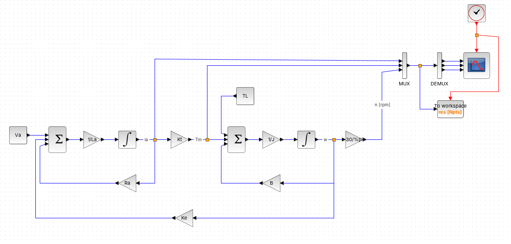
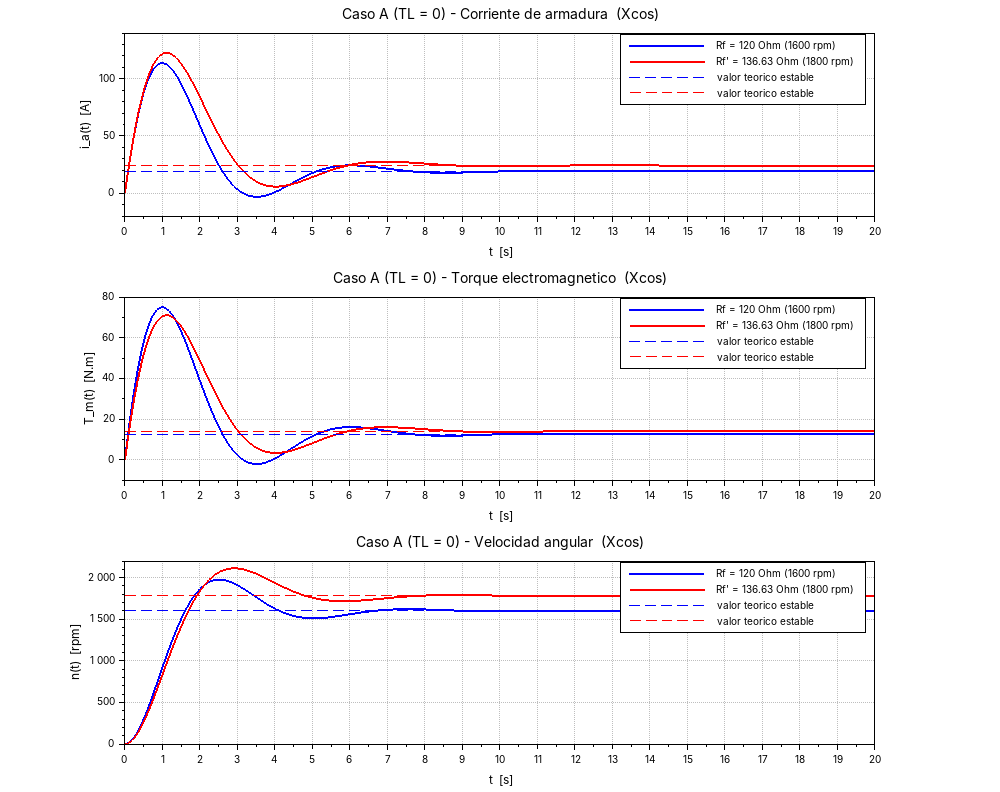
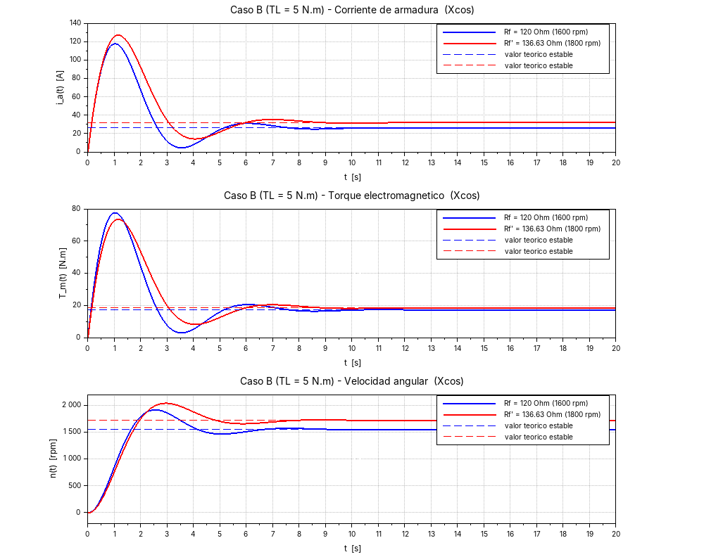
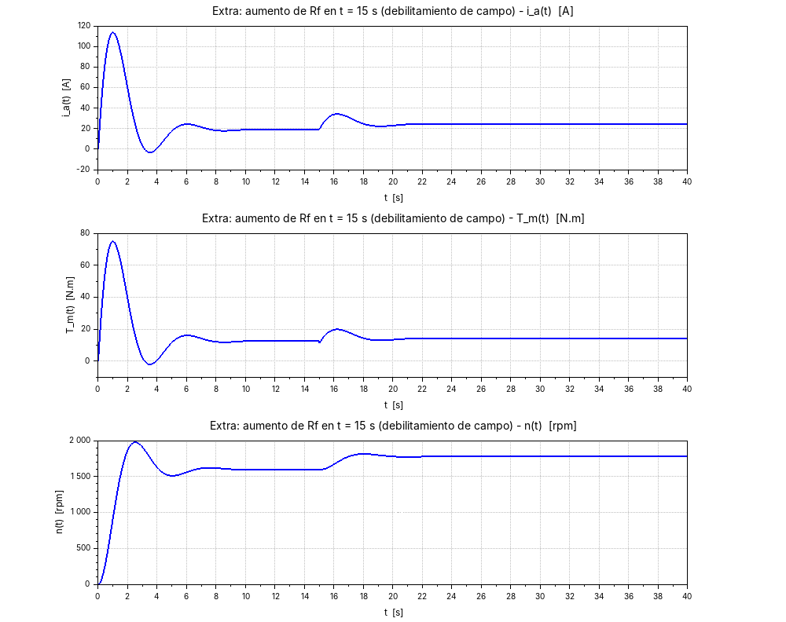

# Guía de estudio: control de velocidad de un motor CD Shunt por campo

> Objetivo de esta guía: que entiendas **por qué** se hace cada paso, para que puedas
> reproducir este tipo de ejercicio en un examen sin la computadora.
> Todos los números de aquí están verificados con tres herramientas independientes:
> el script de Scilab, el diagrama Xcos y una simulación en Python.

---

## 0. Antes de calcular: lee el problema como ingeniero

Antes de escribir una sola ecuación, responde estas cuatro preguntas:

| Pregunta | Respuesta en este problema |
|---|---|
| ¿Qué máquina y qué conexión? | Motor CD **shunt**: campo en **paralelo** con la armadura, ambos a $V_a$ |
| ¿Qué datos tengo del punto inicial? | $V_a=120$ V, $R_a=0.5\ \Omega$, $R_f=120\ \Omega$, $I_L=20$ A, $n_1=1600$ rpm |
| ¿Qué cambia y qué se mantiene? | Cambia $R_f$ (y con ello el flujo $\phi$). **Se mantiene el par** de la carga |
| ¿Qué piden? | $I_f, I_a, E_a, K_e, K_t$; la nueva $R_f'$ para 1800 rpm; y luego simular |

La frase clave del enunciado es **"a par constante"**. Toda la parte A.2 depende de ella.

---

## 1. La física mínima que necesitas (5 ecuaciones)

Circuito equivalente del motor shunt:

```
        IL →
  +  ───┬────────────┬──────
        │            │
       Rf           Ra
        │ If ↓       │ Ia ↓
       (campo)     ( Ea )   ← fuerza contraelectromotriz
        │            │
  −  ───┴────────────┴──────
```

| # | Ecuación | Qué significa |
|---|---|---|
| 1 | $I_f = V_a / R_f$ | El campo ve toda la tensión de línea |
| 2 | $I_L = I_a + I_f$ | LCK en el nodo de entrada |
| 3 | $V_a = E_a + I_a R_a$ | LVK en la armadura (en estado estable) |
| 4 | $E_a = K\phi\,\omega = K_e\,\omega$ | El rotor girando dentro del campo genera una FCEM |
| 5 | $T_m = K\phi\,I_a = K_t\,I_a$ | La corriente en el campo produce par |

**¿Por qué $K_e = K_t$?** Por conservación de la energía. La potencia eléctrica que
"desaparece" en la FCEM es la potencia mecánica que aparece en el eje:

$$E_a I_a = T_m \omega \;\Rightarrow\; (K_e\omega) I_a = (K_t I_a)\omega \;\Rightarrow\; K_e = K_t$$

Esto es cierto **solo en unidades SI** ($K_e$ en V·s/rad, $K_t$ en N·m/A). Si te dan $K_e$
en V/rpm, primero conviértelo. Error típico de examen.

**¿Por qué cambiar $R_f$ cambia la velocidad?** En un circuito magnético lineal (sin
saturación), $\phi \propto I_f$. Entonces:

$$K_e = k_f\, I_f = k_f \frac{V_a}{R_f} \quad\Rightarrow\quad K_e \propto \frac{1}{R_f}$$

Esta proporcionalidad es la que une "la $R_f$ que me piden" con "el $K_e$ que calculo".

---

## 2. Parte A.1 – Punto de operación inicial (1600 rpm)

Sigue siempre el mismo orden: **campo → armadura → FCEM → constantes**.

1. **Corriente de campo:** $I_f = 120/120 = 1\ \text{A}$
2. **Corriente de armadura:** $I_a = I_L - I_f = 20 - 1 = 19\ \text{A}$
   (error clásico: usar $I_a = 20$ A olvidando que parte de la línea va al campo).
3. **FCEM:** $E_a = V_a - I_a R_a = 120 - 19(0.5) = 110.5\ \text{V}$
4. **Velocidad en rad/s:** $\omega_1 = 1600 \cdot \dfrac{2\pi}{60} = 167.552\ \text{rad/s}$
   (¡nunca uses rpm dentro de $E_a = K_e\omega$!).
5. **Constantes:** $K_e = \dfrac{E_a}{\omega_1} = \dfrac{110.5}{167.552} = 0.65950\ \text{V·s/rad} = K_t$
6. **Par:** $T_m = K_t I_a = 0.65950 \times 19 = 12.530\ \text{N·m}$

**Chequeo de coherencia** (hazlo siempre en el examen, toma 10 segundos):
$E_a I_a = 110.5 \times 19 = 2099.5$ W y $T_m\omega_1 = 12.530 \times 167.552 = 2099.5$ W. ✔

---

## 3. Parte A.2 – Nueva $R_f'$ para 1800 rpm a par constante

### 3.1 La trampa conceptual

Muchos estudiantes piensan: "si debilito el campo, la corriente de armadura no cambia".
**Falso.** Si el par es constante y el flujo baja, la corriente **debe subir**:

$$T = K\phi_1 I_{a1} = K\phi_2 I_{a2} \quad\Rightarrow\quad I_{a2} = I_{a1}\frac{\phi_1}{\phi_2}$$

Entonces tenemos **dos incógnitas** ($K_{e2}$ e $I_{a2}$) y necesitamos **dos ecuaciones**:

$$\begin{cases} K_{e2}\, I_{a2} = T = 12.5305 & \text{(par constante)}\\[2pt] V_a = K_{e2}\,\omega_2 + I_{a2} R_a & \text{(LVK armadura)}\end{cases}$$

### 3.2 La ecuación cuadrática

Sustituye $I_{a2} = T/K_{e2}$ en la segunda y multiplica por $K_{e2}$:

$$\boxed{\omega_2 K_{e2}^2 - V_a K_{e2} + T R_a = 0}$$

Con números ($\omega_2 = 1800 \cdot 2\pi/60 = 188.496$ rad/s):

$$188.496\,K_{e2}^2 - 120\,K_{e2} + 6.2652 = 0$$

$$K_{e2} = \frac{120 \pm \sqrt{120^2 - 4(188.496)(6.2652)}}{2(188.496)} = \frac{120 \pm 98.367}{376.99}$$

| Raíz | $K_{e2}$ | $I_{a2} = T/K_{e2}$ | ¿Válida? |
|---|---|---|---|
| + | **0.57924** | **21.63 A** | ✔ Sí |
| − | 0.05738 | 218.4 A | ✘ No: 11× la corriente nominal, flujo al 8.7 %, $E_a\approx 11$ V. Es el punto del otro lado del máximo de potencia ($E_a < V_a/2$): impracticable y destructivo |

**Regla para el examen:** de las dos raíces, la buena es la que da una corriente
"razonable", cercana a la del punto inicial.

### 3.3 De $K_{e2}$ a $R_f'$

Como $K_e \propto I_f \propto 1/R_f$:

$$I_{f2} = I_{f1}\frac{K_{e2}}{K_{e1}} = 1 \times \frac{0.57924}{0.65950} = 0.87830\ \text{A}$$

$$\boxed{R_f' = \frac{V_a}{I_{f2}} = \frac{120}{0.87830} = 136.63\ \Omega}$$

Resultados complementarios: $E_{a2} = 120 - 21.633(0.5) = 109.18$ V
(chequeo: $K_{e2}\omega_2 = 0.57924 \times 188.496 = 109.18$ V ✔), $I_{L2} = 22.51$ A.

### 3.4 Atajo para verificar (aproximación)

Como $E_a$ cambia poco (110.5 → 109.2 V), si suponemos $E_a \approx$ constante:
$\phi_2/\phi_1 \approx n_1/n_2 \Rightarrow R_f' \approx 120 \times 1800/1600 = 135\ \Omega$.
Error de solo 1.2 %. **Úsalo para detectar si tu resultado exacto tiene sentido**, pero
en el examen presenta el método exacto.

### 3.5 Intuición: ¿por qué debilitar el campo **acelera** el motor?

Parece contraintuitivo ("menos campo = más velocidad"). Piénsalo así: en régimen,
$E_a \approx V_a$ casi siempre (la caída $I_aR_a$ es pequeña). Si $\phi$ baja, para generar
la misma $E_a$ el rotor **tiene que girar más rápido**. La fórmula general lo resume:

$$\omega = \frac{V_a}{K\phi} - \frac{R_a\,T}{(K\phi)^2}$$

Corolario de seguridad: **si el campo se abre** ($R_f\to\infty$, $\phi\to 0$) **el motor
se embala** sin carga. Por eso los motores shunt llevan protección por pérdida de campo.

---

## 4. Parte A.3 – Estado estable del **modelo dinámico**

### 4.1 Las ecuaciones diferenciales

Al pasar al dominio del tiempo aparecen la inductancia (que se opone a cambios de
corriente) y la inercia (que se opone a cambios de velocidad):

$$L_a\frac{di_a}{dt} = V_a - R_a i_a - K_e\,\omega$$

$$J\frac{d\omega}{dt} = K_t\, i_a - B\,\omega - T_L$$

En estado estable **las derivadas valen cero**. Resolviendo el sistema 2×2:

$$\boxed{\omega_{ss} = \frac{K_t V_a - R_a T_L}{K_t K_e + R_a B}} \qquad \boxed{i_{a,ss} = \frac{B\,\omega_{ss} + T_L}{K_t}}$$

> Cómo deducirlo en 30 s: de la primera, $i_a = (V_a - K_e\omega)/R_a$; sustituye en la
> segunda $K_t(V_a - K_e\omega)/R_a = B\omega + T_L$ y despeja $\omega$.

### 4.2 Resultados (verificados en Scilab, Xcos y Python)

| Caso | $R_f$ [Ω] | $T_L$ [N·m] | $\omega_{ss}$ [rad/s] | $n_{ss}$ [rpm] | $i_{a,ss}$ [A] | $T_{m,ss}$ [N·m] |
|---|---|---|---|---|---|---|
| A – 1600 | 120 | 0 | 167.514 | **1599.6** | **19.05** | 12.56 |
| B – 1600 | 120 | 5 | 162.222 | **1549.1** | **26.03** | 17.17 |
| A – 1800 | 136.63 | 0 | 186.342 | **1779.4** | **24.13** | 13.98 |
| B – 1800 | 136.63 | 5 | 179.640 | **1715.4** | **31.89** | 18.47 |

### 4.3 ¡Detalle sutil que vale puntos! ¿Por qué 1779 rpm y no 1800?

Observa esto: $B\,\omega_1 = 0.075 \times 167.55 = 12.57$ N·m, prácticamente igual a
$T_m = 12.53$ N·m. **El enunciado eligió $B$ para que la fricción viscosa represente la
carga del punto inicial**. Por eso el Caso A con $R_f = 120\ \Omega$ da 1599.6 rpm: el
modelo reproduce el punto de operación del enunciado. ✔

Pero la carga viscosa **no es de par constante**: crece con la velocidad
($B\omega_2 = 14.14$ N·m a 1800 rpm). Como $R_f'$ se calculó suponiendo par constante
(12.53 N·m), en la simulación el motor tiene más carga de la supuesta y se queda en
1779 rpm (−1.1 %). No es un error del código: es la diferencia entre dos modelos de carga.

- Si quisieras exactamente 1800 rpm en el modelo viscoso: $\omega_2 K_e^2 - V_aK_e + R_aB\omega_2^2 = 0 \Rightarrow R_f = 138.61\ \Omega$.
- **En el informe, menciona esto explícitamente.** Demuestra que entiendes el modelo.

---

## 5. Parte B – Del sistema de ecuaciones al diagrama de bloques

### 5.1 El método universal (sirve para cualquier sistema físico)

1. **Despeja la derivada de mayor orden** de cada ecuación:
   $\dfrac{di_a}{dt} = \dfrac{1}{L_a}\left(V_a - R_a i_a - K_e\omega\right)$,
   $\dfrac{d\omega}{dt} = \dfrac{1}{J}\left(K_t i_a - B\omega - T_L\right)$
2. **Un integrador por cada variable de estado.** La salida del integrador es la
   variable ($i_a$, $\omega$); su entrada es la derivada.
3. **Construye la entrada del integrador** con un sumador + ganancia ($1/L_a$, $1/J$).
4. **Cierra los lazos:** toda variable que aparece en el lado derecho se "realimenta"
   desde la salida del integrador correspondiente con su ganancia ($R_a$, $K_e$, $B$, $K_t$).

### 5.2 El diagrama (archivo `APELLIDO_NOMBRE.zcos`)



Lectura de izquierda a derecha:

| Bloque | Función física |
|---|---|
| `Va` → Σ(+,−,−) | Tensión aplicada menos FCEM ($K_e\omega$) menos caída resistiva ($R_a i_a$) = tensión sobre $L_a$ |
| `1/La` → ∫ | La tensión en la inductancia define cómo cambia la corriente → $i_a$ |
| `Kt` | Acoplamiento electromecánico: corriente → par $T_m$ |
| Σ(−,+,−) | Par neto = $T_m - T_L - B\omega$ (signos: entrada 1 = $T_L$, 2 = $T_m$, 3 = $B\omega$) |
| `1/J` → ∫ | El par neto acelera la inercia → $\omega$ |
| `Ke` (lazo inferior) | **Realimentación natural** del motor: al acelerar, la FCEM crece y limita la corriente |
| `Ra`, `B` | Pérdidas: lazos de realimentación negativa locales |
| `30/%pi` | Conversión rad/s → rpm para graficar |
| MUX → DEMUX → Scope; *To workspace* | Visualización y exportación de $[i_a, T_m, n]$ a la variable `res` |

**Detalle didáctico:** el lazo $K_e$ es lo que hace al motor CD "autorregulado". Sin él,
la corriente crecería sin límite. Ese lazo es el que **modificamos al cambiar $R_f$**.

### 5.3 Contexto parametrizado (para cambiar de caso sin tocar bloques)

En **Simulación → Establecer contexto** el diagrama calcula $K_e$ desde $R_f$:

```scilab
Rf = 120;      // 120 -> 1600 rpm  |  136.63 -> 1800 rpm
TL = 0;        // 0 -> Caso A      |  5 -> Caso B
If = Va/Rf;  Ke = kf*If;  Kt = Ke;
```

Así **el control por campo queda modelado como lo que es físicamente**: cambias una
resistencia y el flujo cambia. Para correr los cuatro casos solo editas esas dos líneas.

### 5.4 Ajustes de simulación

- Tiempo final 20 s (el sistema se asienta en ~7 s), muestreo `dt = 0.01` s.
- Solver LSodar, tolerancias rtol = 1e-8, atol = 1e-6.
- Condiciones iniciales nulas: el motor arranca desde reposo con $i_a(0)=0$.

### 5.5 Si tuvieras que armarlo a mano en Xcos

1. `Sources → CONST_m` (×2: `Va`, `TL`), `CLOCK_c`.
2. `Mathematical Operations → SUMMATION` (×2, signos `[1;-1;-1]` y `[-1;1;-1]`), `GAINBLK` (×8).
3. `Continuous → INTEGRAL_m` (×2).
4. `Signal Routing → MUX`, `DEMUX`; `Sinks → CMSCOPE`, `TOWS_c`.
5. Para voltear un bloque de realimentación: selecciónalo y **Format → Mirror** (Ctrl+M).
6. Pega el contexto, conecta y simula. Los nodos de bifurcación se crean arrastrando
   desde un enlace existente.

---

## 6. Interpretar los resultados (lo que el profesor quiere leer)





| Indicador | 1600 / A | 1600 / B | 1800 / A | 1800 / B |
|---|---|---|---|---|
| $i_{a,\max}$ en el arranque | 113.6 A @ 1.00 s | 117.7 A @ 1.03 s | 122.6 A @ 1.11 s | 126.9 A @ 1.15 s |
| $n_{\max}$ (sobreimpulso) | 1976 rpm (23.5 %) | 1914 rpm (23.6 %) | 2112 rpm (18.7 %) | 2037 rpm (18.7 %) |
| $t_s$ (2 %) | 6.1 s | 6.2 s | 6.8 s | 6.8 s |
| $n_{ss}$ / $i_{a,ss}$ | 1599.6 / 19.05 | 1549.1 / 26.03 | 1779.4 / 24.13 | 1715.4 / 31.89 |

### 6.1 Dinámica: un sistema de 2.º orden subamortiguado

Polinomio característico: $L_aJ\,s^2 + (R_aJ + L_aB)\,s + (R_aB + K_tK_e) = 0$

| | $\omega_n$ [rad/s] | $\zeta$ | $M_p$ teórico | Polos |
|---|---|---|---|---|
| $R_f = 120$ | 1.375 | 0.418 | 23.5 % | $-0.575 \pm j1.249$ |
| $R_f' = 136.63$ | 1.222 | 0.471 | 18.7 % | $-0.575 \pm j1.078$ |

Observaciones con las que puedes lucirte:

- **El sobreimpulso teórico coincide con la simulación** (23.5 % y 18.7 %). Es la prueba
  de que el modelo y el código son coherentes.
- **La parte real de los polos no depende de $K_e$**: $\sigma = \tfrac12\left(\tfrac{R_a}{L_a}+\tfrac{B}{J}\right) = 0.575$ s⁻¹.
  Por eso el tiempo de asentamiento es casi igual en todos los casos.
- Debilitar el campo baja $\omega_n$ y sube $\zeta$: respuesta **más lenta y más amortiguada**.
  Con menos flujo, el lazo de FCEM "frena" menos.
- $\tau_e = L_a/R_a = 1$ s es **grande** (en motores reales suele ser de ms). Por eso el pico
  de corriente ocurre cerca de 1 s y vale ~114 A en vez de los $V_a/R_a = 240$ A que tendría
  un motor con $L_a$ pequeña.

### 6.2 ¿Por qué la corriente se vuelve negativa (~ −3 A) cerca de t = 3.5 s?

Porque la velocidad sobrepasa su valor final: con $n = 1976$ rpm,
$E_a = 0.6595 \times 206.9 = 136.5\ \text{V} > V_a = 120$ V. Durante un instante la
máquina **funciona como generador** y devuelve energía a la fuente (frenado regenerativo
natural). No es un error numérico: es física.

### 6.3 Efecto de la carga (Caso B)

- La velocidad cae: 1599.6 → 1549.1 rpm (−3.2 %) con 1600, y 1779.4 → 1715.4 rpm (−3.6 %) con 1800.
- La corriente sube para producir el par extra: $\Delta i_a = T_L/K_t$ más el efecto de fricción.
- **Con campo debilitado la caída de velocidad es mayor** y la corriente es mayor
  (31.9 A vs 26.0 A): con menos flujo, el motor necesita más amperios por cada N·m.

### 6.4 Extra: cómo se ve el control "en caliente"



El motor arranca con $R_f = 120\ \Omega$ y en $t = 15$ s se cambia a $R_f'$. Al bajar el flujo,
la FCEM cae de golpe, la corriente sube (pico de 34 A), aparece par extra y el motor
acelera hasta 1779 rpm. Esto es lo que ocurre en la práctica cuando se gira el reóstato de campo.

---

## 7. Conclusiones técnicas (para tu informe)

**Ventajas del control por corriente de campo**

1. **Se controla mucha potencia con poca:** $I_f \approx 1$ A frente a $I_a \approx 20$ A. El
   reóstato de campo disipa poco (la potencia del campo baja de 120 W a 105 W).
2. **Eficiente:** no se intercala resistencia en la armadura, así que no se desperdicia
   energía como en el control por reóstato de armadura.
3. **Ajuste suave y continuo** de la velocidad **por encima de la velocidad base**.
4. Pequeños cambios de $R_f$ producen grandes cambios de velocidad (+13.9 % de $R_f$ → +12.5 % de $n$).

**Limitaciones**

1. **Solo permite subir la velocidad** (debilitar el campo). Para bajar de la velocidad
   base se usa control por tensión de armadura.
2. **A par constante la corriente de armadura aumenta** (19 → 21.6 A): mayor calentamiento.
   La región de debilitamiento de campo es, en la práctica, una región de *potencia constante*.
3. **Peor regulación ante carga:** la caída de velocidad con $T_L$ es mayor con campo débil.
4. **Riesgo de embalamiento** si el campo se abre; requiere protección.
5. El modelo supone **flujo proporcional a $I_f$** (sin saturación ni reacción de armadura) y
   cambio instantáneo del flujo (se desprecia $L_f$). Con saturación, el $R_f'$ real sería distinto.
6. El resultado depende del **modelo de carga**: con carga viscosa pura se obtienen
   1779 rpm en lugar de 1800 (se necesitarían 138.6 Ω).

---

## 8. Receta para el examen y errores típicos

### Receta en 7 pasos

1. Dibuja el circuito equivalente y escribe las 5 ecuaciones de la sección 1.
2. Convierte **todas** las velocidades a rad/s.
3. Punto inicial: $I_f \to I_a \to E_a \to K_e = K_t \to T$.
4. Identifica la condición de carga: **¿par constante? ¿corriente constante? ¿potencia constante?**
5. Si cambia el flujo con par constante → **ecuación cuadrática** en $K\phi$; elige la raíz razonable.
6. Usa $K_e \propto I_f \propto 1/R_f$ para encontrar la nueva resistencia.
7. **Verifica**: $E_aI_a = T\omega$, y la aproximación $R_f' \approx R_f\, n_2/n_1$.

### Errores que más se cometen

| Error | Consecuencia |
|---|---|
| Usar $I_a = I_L$ (olvidar $I_f$) | $E_a$, $K_e$ y todo lo demás mal |
| Usar rpm en $E_a = K_e\omega$ | $K_e$ con factor 9.55 de error |
| Suponer $I_a$ constante al cambiar el flujo | Ignora que $T = K\phi I_a$ |
| Tomar la raíz pequeña de la cuadrática | Corriente absurda (218 A) |
| Escribir $R_f' = R_f\, K_{e2}/K_{e1}$ (al revés) | La relación es inversa: $R_f' = R_f\,K_{e1}/K_{e2}$ |
| Signos mal en el sumador de Xcos | La simulación diverge o da velocidad negativa |
| Olvidar $B\omega$ en el estado estable dinámico | Valores que no coinciden con la simulación |

### Tabla de variantes que pueden preguntarte

| Método | Qué cambia | Rango | Ecuación clave |
|---|---|---|---|
| **Campo ($R_f$)** | $\phi$ | Por encima de la base | $\omega_2K\phi_2^2 - V_aK\phi_2 + TR_a = 0$ |
| Tensión de armadura | $V_a$ | Por debajo de la base | $\phi$ e $I_a$ constantes: $V_{a2} = K_e\omega_2 + I_aR_a$ |
| Resistencia en armadura | $R_a + R_{ext}$ | Por debajo de la base (ineficiente) | $R_{ext} = (V_a - K_e\omega_2)/I_a - R_a$ |

---

## 9. Ejercicios de práctica (con respuesta)

Mismo motor, mismo par de carga (12.53 N·m), $\phi \propto I_f$:

1. ¿Qué $R_f$ se necesita para 2000 rpm? → **$K_e = 0.51486$, $R_f = 153.7\ \Omega$, $I_a = 24.34$ A**
2. ¿Y para 1700 rpm? → **$K_e = 0.61703$, $R_f = 128.3\ \Omega$, $I_a = 20.31$ A**
3. Con $R_f = 120\ \Omega$, ¿qué resistencia externa en serie con la armadura baja la velocidad
   a 1400 rpm? (pista: el flujo no cambia → $I_a$ se mantiene en 19 A)
   → **$E_a = 96.69$ V, $R_{ext} = 0.727\ \Omega$**
4. ¿Qué tensión de armadura (con el campo alimentado aparte y fijo) da 1400 rpm? → **$V_a = 106.19$ V**
5. Pregunta conceptual: ¿cuál es la velocidad **máxima teórica** alcanzable por debilitamiento
   de campo a par constante? (pista: cuando el discriminante vale 0)
   → $\omega_{\max} = V_a^2/(4TR_a) = 574.6$ rad/s ≈ 5487 rpm, con $E_a = V_a/2$
   (es la condición de máxima transferencia de potencia; en la realidad la conmutación
   y los esfuerzos mecánicos limitan mucho antes).

---

## 10. Archivos y cómo usarlos

| Archivo | Qué hace |
|---|---|
| `calculos_motor_shunt.sce` | Parte A completa (memoria de cálculo en consola) + simulación con `ode()` + simulación del `.zcos` + gráficas |
| `generar_xcos.sce` | Construye el diagrama por código y lo guarda como `APELLIDO_NOMBRE.zcos` |
| `APELLIDO_NOMBRE.zcos` | Diagrama Xcos entregable (renómbralo con tu apellido y nombre) |
| `figuras/` | Gráficas PNG generadas por el script |
| `verificacion_python.py` | Verificación independiente (opcional) |
| `informe/` | Borrador del informe técnico (Markdown → PDF/DOCX) |

**Orden de ejecución en Scilab** (en la consola, desde esta carpeta):

```scilab
exec("generar_xcos.sce", -1)          // solo si quieres regenerar el diagrama
exec("calculos_motor_shunt.sce", -1)  // cálculos + simulaciones + gráficas
xcos("APELLIDO_NOMBRE.zcos")          // abrir el diagrama y simular a mano
```

> Si renombras el `.zcos`, cambia también la variable `archivo_xcos` al inicio de la
> sección B.2 de `calculos_motor_shunt.sce` (y `archivo` en `generar_xcos.sce`).
