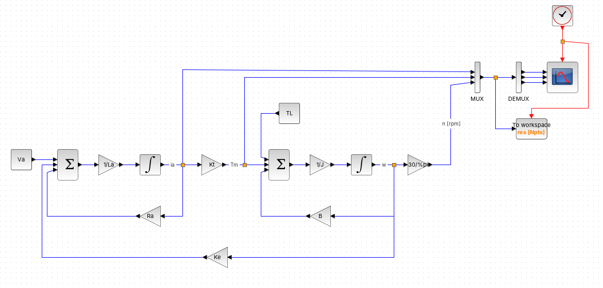
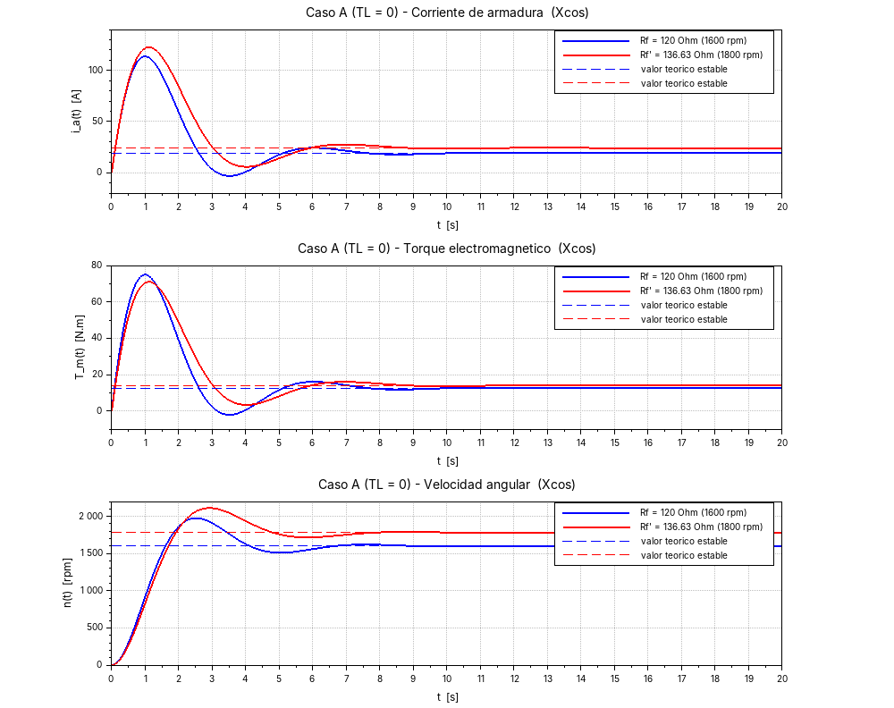
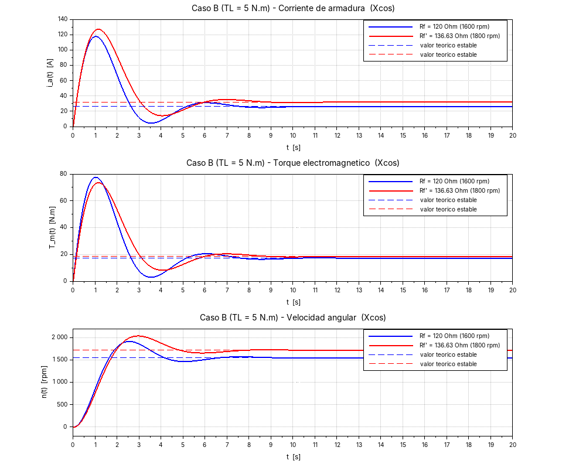

# 1. Objetivo

Modelar, simular y analizar el control de velocidad de un motor de corriente directa en
conexión shunt, elevando su velocidad de 1600 rpm a 1800 rpm mediante el ajuste de la
resistencia del devanado de campo ($R_f$), con una carga de par constante.

# 2. Planteamiento y datos

Motor CD shunt alimentado con $V_a = 120$ V, $R_a = 0.5\ \Omega$, $R_f = 120\ \Omega$. A 1600 rpm
absorbe $I_L = 20$ A de la red. Parámetros dinámicos: $L_a = 0.5$ H, $J = 0.5$ kg·m²,
$B = 0.075$ N·m·s/rad.

**Supuestos del modelo:** circuito magnético lineal ($\phi \propto I_f$), sin reacción de
armadura, sin saturación, flujo de campo constante durante cada simulación (se desprecia
$L_f$), pérdidas rotacionales representadas por $B\omega$.

**Ecuaciones fundamentales:**

$$I_f = \frac{V_a}{R_f},\qquad I_L = I_a + I_f,\qquad V_a = E_a + I_aR_a,\qquad E_a = K_e\,\omega,\qquad T_m = K_t\,I_a$$

En unidades SI, el balance de potencia $E_aI_a = T_m\omega$ implica $K_e = K_t$.

# 3. Memoria de cálculo (Parte A)

## 3.1 Punto de operación inicial (1600 rpm)

| Magnitud | Expresión | Resultado |
|---|---|---|
| Velocidad angular | $\omega_1 = 1600\cdot 2\pi/60$ | 167.552 rad/s |
| Corriente de campo | $I_f = 120/120$ | **1.000 A** |
| Corriente de armadura | $I_a = 20 - 1$ | **19.000 A** |
| Fuerza contraelectromotriz | $E_a = 120 - 19(0.5)$ | **110.500 V** |
| Constante de FCEM | $K_e = 110.5/167.552$ | **0.65950 V·s/rad** |
| Constante de par | $K_t = K_e$ | **0.65950 N·m/A** |
| Par electromagnético | $T = K_tI_a$ | 12.5305 N·m |
| Verificación | $E_aI_a = T\omega_1$ | 2099.5 W = 2099.5 W ✔ |

## 3.2 Nueva resistencia de campo para 1800 rpm a par constante

Con par constante, $K_{e2}I_{a2} = K_{e1}I_{a1} = T$. Sustituyendo $I_{a2} = T/K_{e2}$ en
$V_a = K_{e2}\omega_2 + I_{a2}R_a$:

$$\omega_2K_{e2}^2 - V_aK_{e2} + TR_a = 0 \;\Rightarrow\; 188.496\,K_{e2}^2 - 120\,K_{e2} + 6.2652 = 0$$

$$K_{e2} = \frac{120 \pm \sqrt{9676.13}}{376.991} = \{0.57924;\ 0.05738\}$$

La raíz menor exige $I_a = 218.4$ A (11 veces la corriente nominal) con $E_a \approx 10.8$ V:
se descarta por impracticable. Con $K_{e2} = 0.57924$ V·s/rad:

| Magnitud | Expresión | Resultado |
|---|---|---|
| Corriente de armadura | $I_{a2} = T/K_{e2}$ | 21.633 A |
| FCEM | $E_{a2} = 120 - 21.633(0.5)$ | 109.184 V ($=K_{e2}\omega_2$ ✔) |
| Corriente de campo | $I_{f2} = I_{f1}K_{e2}/K_{e1}$ | 0.87830 A |
| **Resistencia de campo** | $R_f' = V_a/I_{f2}$ | **136.63 Ω** |
| Corriente de línea | $I_{L2} = I_{a2} + I_{f2}$ | 22.511 A |

Comprobación aproximada ($E_a\approx$ cte): $R_f' \approx 120\cdot1800/1600 = 135\ \Omega$ (diferencia 1.2 %).

## 3.3 Valores teóricos en estado estable del modelo dinámico

Haciendo $di_a/dt = 0$ y $d\omega/dt = 0$ en las ecuaciones de la sección 4:

$$\omega_{ss} = \frac{K_tV_a - R_aT_L}{K_tK_e + R_aB},\qquad i_{a,ss} = \frac{B\omega_{ss} + T_L}{K_t}$$

| Caso | $R_f$ [Ω] | $T_L$ [N·m] | $\omega_{ss}$ [rad/s] | $n_{ss}$ [rpm] | $i_{a,ss}$ [A] | $T_{m,ss}$ [N·m] |
|---|---|---|---|---|---|---|
| A, 1600 rpm | 120 | 0 | 167.514 | 1599.6 | 19.050 | 12.564 |
| B, 1600 rpm | 120 | 5 | 162.222 | 1549.1 | 26.030 | 17.167 |
| A, 1800 rpm | 136.63 | 0 | 186.342 | 1779.4 | 24.128 | 13.976 |
| B, 1800 rpm | 136.63 | 5 | 179.640 | 1715.4 | 31.892 | 18.473 |

**Observación.** $B\omega_1 = 12.57$ N·m $\approx T = 12.53$ N·m: en el modelo dinámico la
fricción viscosa representa la carga del punto inicial, por lo que el Caso A con
$R_f = 120\ \Omega$ reproduce los 1600 rpm. Sin embargo, la carga viscosa crece con la
velocidad ($B\omega_2 = 14.14$ N·m), por lo que con $R_f' = 136.63\ \Omega$ (calculada a par
constante) el modelo alcanza 1779.4 rpm. Para 1800 rpm exactos con carga puramente viscosa
se requeriría $R_f = 138.61\ \Omega$.

# 4. Modelo dinámico y diagrama de bloques (Parte B)

$$L_a\frac{di_a}{dt} = V_a - R_ai_a - K_e\omega \qquad\qquad J\frac{d\omega}{dt} = K_ti_a - B\omega - T_L$$

Cada ecuación se implementa despejando la derivada e integrándola: el primer lazo
(sumador $[+,-,-]$, ganancia $1/L_a$, integrador) produce $i_a$; la ganancia $K_t$ genera el
par; el segundo lazo (sumador $[-,+,-]$ con $T_L$, $T_m$ y $B\omega$, ganancia $1/J$, integrador)
produce $\omega$. Las realimentaciones $R_ai_a$, $B\omega$ y $K_e\omega$ cierran el modelo. El
contexto del diagrama calcula $K_e = k_fV_a/R_f$ con $k_f = K_{e1}/I_{f1}$, de modo que cada
caso se simula cambiando solo $R_f$ y $T_L$. Simulación: 0–20 s, solver LSodar,
rtol $=10^{-8}$, muestreo 0.01 s, condiciones iniciales nulas.

# 5. Resultados de simulación

| Indicador | 1600 / A | 1600 / B | 1800 / A | 1800 / B |
|---|---|---|---|---|
| $i_{a,\max}$ [A] (instante) | 113.6 (1.00 s) | 117.7 (1.03 s) | 122.6 (1.11 s) | 126.9 (1.15 s) |
| $T_{m,\max}$ [N·m] | 74.9 | 77.6 | 71.0 | 73.5 |
| $n_{\max}$ [rpm] | 1976.1 | 1914.0 | 2112.3 | 2036.7 |
| Sobreimpulso de $n$ | 23.5 % | 23.6 % | 18.7 % | 18.7 % |
| $t_s$ (2 %) [s] | 6.1 | 6.2 | 6.8 | 6.8 |
| $n$ final [rpm] | 1599.6 | 1549.1 | 1779.4 | 1715.4 |
| $i_a$ final [A] | 19.05 | 26.03 | 24.13 | 31.89 |

**Validación.** Los valores finales coinciden con la tabla de la sección 3.3. La simulación
del diagrama Xcos y la integración directa de las EDO con `ode()` difieren en menos de
$5\times10^{-4}$ A y $4\times10^{-3}$ rpm; una tercera verificación en Python (`solve_ivp`)
reproduce los mismos valores.

# 6. Análisis

**Dinámica.** El polinomio característico $L_aJs^2 + (R_aJ + L_aB)s + (R_aB + K_tK_e)$ da
polos $-0.575 \pm j1.249$ ($\omega_n = 1.375$ rad/s, $\zeta = 0.418$) para $R_f = 120\ \Omega$ y
$-0.575 \pm j1.078$ ($\omega_n = 1.222$ rad/s, $\zeta = 0.471$) para $R_f'$. Los sobreimpulsos
teóricos (23.5 % y 18.7 %) coinciden con los simulados. La parte real
$\sigma = \tfrac12(R_a/L_a + B/J)$ no depende del flujo, por lo que los tiempos de
asentamiento son similares. Debilitar el campo reduce $\omega_n$ y aumenta $\zeta$: la
respuesta es más lenta y más amortiguada.

**Arranque.** La constante de tiempo eléctrica $\tau_e = L_a/R_a = 1$ s limita el pico de
corriente a unas 6 veces la corriente nominal (≈114–127 A frente a $V_a/R_a = 240$ A).
Hacia $t \approx 3.5$ s la velocidad supera su valor final, $E_a > V_a$ y la corriente se
vuelve ligeramente negativa: la máquina actúa brevemente como generador.

**Efecto del campo.** Al pasar de 120 Ω a 136.63 Ω la velocidad final sube de 1599.6 a
1779.4 rpm (Caso A) y la corriente de armadura de 19.05 a 24.13 A, porque con menor flujo
se requieren más amperios para el mismo par.

**Efecto de la carga.** Con $T_L = 5$ N·m la velocidad cae 3.2 % con el campo pleno y 3.6 %
con el campo debilitado; la corriente sube a 26.0 A y 31.9 A respectivamente. El motor con
campo debilitado tiene peor regulación de velocidad.

# 7. Conclusiones

1. El control por corriente de campo permite elevar la velocidad por encima de la base
   manejando una corriente pequeña ($I_f \approx 1$ A frente a $I_a \approx 20$ A) y con pérdidas
   reducidas en el reóstato; un aumento de 13.9 % en $R_f$ produce un aumento de 12.5 % en la
   velocidad.
2. A par constante, la reducción del flujo obliga a aumentar la corriente de armadura
   (19.0 → 21.6 A), lo que incrementa el calentamiento: el método opera en la práctica en
   una región de potencia constante y está limitado por la corriente nominal.
3. El método solo permite aumentar la velocidad, empeora la regulación ante cambios de
   carga y presenta riesgo de embalamiento si el circuito de campo se abre.
4. El modelo dinámico es de segundo orden subamortiguado; el debilitamiento de campo hace
   la respuesta más lenta y más amortiguada, y el sobreimpulso cae de 23.5 % a 18.7 %.
5. El resultado depende del modelo de carga: con $R_f' = 136.63\ \Omega$ se obtienen 1800 rpm
   con carga de par constante, pero 1779.4 rpm cuando la carga es puramente viscosa.
6. El modelo supone flujo proporcional a $I_f$ y desprecia la saturación, la reacción de
   armadura y la dinámica del campo; con saturación, el valor real de $R_f'$ sería distinto.

# Anexos

- `calculos_motor_shunt.sce`: memoria de cálculo, simulación con `ode()` y del diagrama Xcos, gráficas.
- `generar_xcos.sce`: generación programática del diagrama.
- `Diaz_Diego.zcos`: diagrama de bloques en Xcos.
